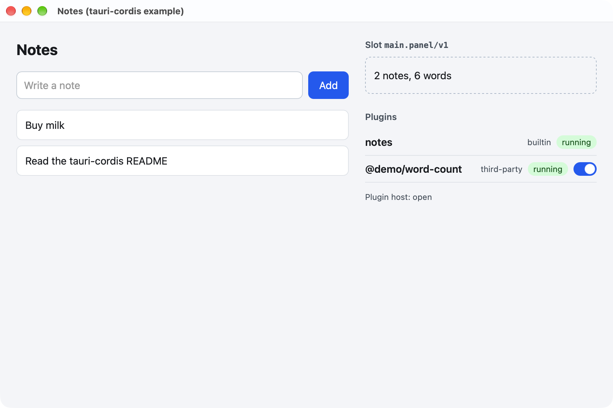

# tauri-cordis

**Let the people who use your Tauri app extend it.** Built-in features and third-party extensions are the same kind of thing, a plugin, and each one can be switched on, off or replaced while the app is running.

[](https://www.npmjs.com/package/tauri-cordis) [](https://crates.io/crates/tauri-cordis) [](https://github.com/TixXin/tauri-cordis/actions/workflows/ci.yml) [](./LICENSE)

English | [简体中文](./README.zh-CN.md)

tauri-cordis is the plugin runtime taken out of [Fuyu](https://github.com/TixXin/fuyu), a desktop island for Windows and macOS. Fuyu runs this architecture in production: its 22 built-in features (clipboard history, translation, lyrics, todos and the rest) are plugins, and so are the 12 official plugins in its signed market.

<p align="center">
  <a href="https://github.com/TixXin/fuyu"></a>
</p>

> **This is not a `tauri-plugin-*`.** A Tauri plugin is a Rust crate that you, the developer, compile into your app to give it a capability. tauri-cordis is for the other direction: code that your users install into your app after it has shipped.

## What it gives you

- **One plugin model for everything.** A plugin is a Node module for logic and, if it has UI, a React component per window. Its manifest is its `package.json`.
- **Versioned services.** Plugins talk through typed services with a version in the name (`notes/v1`). A plugin that needs one starts only when someone provides it, stops when the provider goes away, and starts again when it comes back.
- **Slots for UI.** Your windows declare named places (`main.panel/v1`). Plugins put components into them. Every item has its own error boundary, so one broken plugin does not blank the window.
- **Side effects that undo themselves.** Timers, listeners, services and slot items registered through `ctx` are removed when the plugin stops. Loading and unloading a plugin 1000 times leaves no handles behind, and there is a test that says so.
- **A supervised host.** Plugins run in one headless Node process that Rust starts, pings, and restarts with backoff. The host quits when its pipe to your app closes, and a `Containment` hook lets you put it in a Job Object or process group as well. Windows reach it over a local WebSocket guarded by a per-launch token.
- **The supply chain, not only the runtime.** Manifest validation, reproducible packages, Ed25519 signatures, a signed market index with a revocation list, and a review tool that diffs two versions of a plugin and grades the risk.
- **Over 60 written guarantees, each held by a test.** See [docs/guarantees.md](./docs/guarantees.md).

## What a plugin looks like

A service, declared once and shared by whoever provides or uses it:

```ts
import { defineService } from "tauri-cordis/services";

type Note = { id: number; text: string };

export const notesV1 = defineService<
  { list(): Note[]; add(params: { text: string }): Note },
  { added: Note }
>("notes/v1", {
  methods: { list: true, add: true },
  events: { added: true },
});
```

The part of a plugin that runs in the Node host:

```ts
import type { Context } from "tauri-cordis";
import { notesV1 } from "./services";

export const name = "word-count";
export const inject = ["clients", "notes/v1"]; // start only once notes/v1 is provided

export async function apply(ctx: Context) {
  const notes = ctx.services.get(notesV1);
  let count = (await notes.list()).length;

  ctx.clients.handle("count", () => count); // the window part can call this
  notes.on("added", () => {
    count += 1;
    ctx.clients.publish("changed", count);
  });
}
```

The part that runs in a window:

```tsx
import { useEffect, useState } from "react";
import type { Context } from "tauri-cordis";

export default function apply(ctx: Context) {
  function Count() {
    const [count, setCount] = useState(0);
    useEffect(() => {
      void ctx.host.call<number>("count").then(setCount);
      const off = ctx.host.on("changed", setCount);
      return () => void off();
    }, []);
    return <span>{count} notes</span>;
  }

  ctx.slots.add("main.panel/v1", { id: "word-count", component: Count });
}
```

Nothing in either file cleans up after itself. When the plugin is switched off, the handler, the subscription and the slot item go with it.

On the app side, a built-in plugin can reach native code through a method you write in Rust:

```rust
use tauri_cordis::host_service;

#[host_service("storage.write", inject(store))]
fn write(store: Store, text: String) -> Result<Note, String> {
    store.add(text)
}
```

```ts
const note = await ctx.rust.call("storage.write", { text }); // built-in plugins only
```

and the window shows whatever plugins have put in a slot:

```tsx
<SlotItems registry={slots} name="main.panel/v1" />
```

## Try it

A small notes app with a real window, a built-in plugin, and a third-party one you can switch off while it runs:

```bash
git clone https://github.com/TixXin/tauri-cordis
cd tauri-cordis
pnpm install
pnpm --filter tauri-cordis-example-notes tauri dev
```

See [examples/tauri-app](./examples/tauri-app).

<p align="center">
  <a href="./examples/tauri-app"></a>
</p>

If you only want to see the protocol, the same four layers run without a window, with a Node script standing in for the native shell:

```bash
node packages/tauri-cordis/examples/minimal-app/run.mjs
```

To write a plugin for an app that already uses tauri-cordis:

```bash
npm create tauri-cordis-plugin@latest my-plugin
```

## How it fits together

```text
┌──────────────────────────────┐    stdio JSON-RPC     ┌───────────────────────────────┐
│ Native shell (Rust, Tauri)   │ <-------------------> │ Plugin host (Node, headless)  │
│  starts, pings, restarts     │                       │  Cordis context and loader    │
│  #[host_service] methods     │                       │  service registry             │
└──────────────────────────────┘                       │  host part of every plugin    │
               ^                                       └───────────────────────────────┘
               │ invoke                                                ^
               v                                                       │ WebSocket on 127.0.0.1
┌──────────────────────────────────────────────────────────────────────┴────────────────┐
│ WebView windows (React)                                                               │
│  slot registry · window services · window part of every plugin                        │
└───────────────────────────────────────────────────────────────────────────────────────┘
```

- [Concepts](./docs/concepts.md): plugins, services, slots, lifecycle, the two halves of a plugin.
- [Adding it to your app](./docs/getting-started.md): the Rust side, the window side, built-in plugins.
- [Writing a plugin](./docs/writing-plugins.md): the manifest, `ctx`, the CLI, packaging.
- [Security model](./docs/security.md): what is protected and what is not.

## What it costs

Read this before you choose it.

- **You ship with Node.** The host needs Node 22.15 or newer. The Rust crate looks for one on the machine and, if there is none, downloads an official build and checks its SHA-256. In Fuyu the idle host process takes about 25 MB on macOS, and cold start is the same with it on or off ([measurements](https://github.com/TixXin/fuyu/blob/main/docs/investigations/v3-kernel-measurements.md), in Chinese). Putting the host script into your app bundle is your job in 0.2; see [before you ship](./docs/getting-started.md#before-you-ship).
- **Plugins are not sandboxed.** A plugin's host part is ordinary Node code with the user's permissions. That is what "equal" means, and it is why plugins can do real work. The protection is before installation: signatures, review and revocation. If you need to run code you do not trust at all, use a sandboxed design instead. Details in the [security model](./docs/security.md).
- **React for plugin UI.** Slots render React components, and plugins share the app's copy of React.
- **It is 0.x.** Interfaces can still change between minor versions. What is stable and what is not is listed in [docs/stability.md](./docs/stability.md).
- **Some defaults are fixed.** The host reads the manifest key `cordis` only, and the slot types list a built-in set of slot names. Each one is listed in [stability](./docs/stability.md#default-names), with what you can do about it.

## How it compares

| | What it is for | Loaded | Isolation |
|---|---|---|---|
| **tauri-cordis** | Users extend your app; your own features are plugins too | At run time, on and off without a restart | None between plugin and app; a separate process from the UI |
| `tauri-plugin-*` | You add a capability to your app | At compile time | Tauri's capability and permission system |
| Sandboxed plugins (WebAssembly, iframes) | Running code you do not trust | At run time | Strong; plugins get only what you pass in |
| Cordis on its own | The context, service and disposal kernel | At run time | None |

tauri-cordis is Cordis plus what a desktop app needs around it: the process supervisor, the bridge to windows, UI slots, and the packaging and market tools. If you know the extension host of a code editor, the shape is similar.

## Packages

| Package | Registry | What it is |
|---|---|---|
| [`tauri-cordis`](./packages/tauri-cordis) | npm | Plugin API, the Node host, the window client, React slots, services |
| [`@tauri-cordis/cli`](./packages/cli) | npm | `tauri-cordis-plugin`: build, pack, check, dev, review, keygen, sign |
| [`create-tauri-cordis-plugin`](./packages/create-plugin) | npm | Scaffolds a plugin project |
| [`@tauri-cordis/manifest`](./packages/manifest) | npm | Manifest validation, reproducible zip packages, signatures |
| [`@tauri-cordis/market`](./packages/market) | npm | Signed market index, revocation list, cooldown, version selection |
| [`@tauri-cordis/review`](./packages/review) | npm | Diffs two versions of a plugin and grades the change green, yellow or red |
| [`tauri-cordis`](./crates/tauri-cordis) | crates.io | Host supervisor, Node finder and downloader, JSON-RPC, method serving |
| [`tauri-cordis-macros`](./crates/tauri-cordis-macros) | crates.io | `#[host_service]`, with TypeScript declarations through `ts-rs` |

## Where the code comes from

tauri-cordis is developed inside [Fuyu's repository](https://github.com/TixXin/fuyu) and published from here. The source in this repository is generated from Fuyu's by one export script, and CI checks that the two match. Issues and pull requests are welcome here; see [CONTRIBUTING.md](./CONTRIBUTING.md).

## Thanks

- [Cordis](https://github.com/cordiverse/cordis) by Shigma and the Cordiverse contributors is the kernel: contexts, services, and effects that are undone when a plugin goes. A built copy lives in [`packages/tauri-cordis/vendor`](./packages/tauri-cordis/vendor) with its license and a short list of local patches.
- [Tauri](https://tauri.app) is the shell this was built for.

## License

[MIT](./LICENSE)
