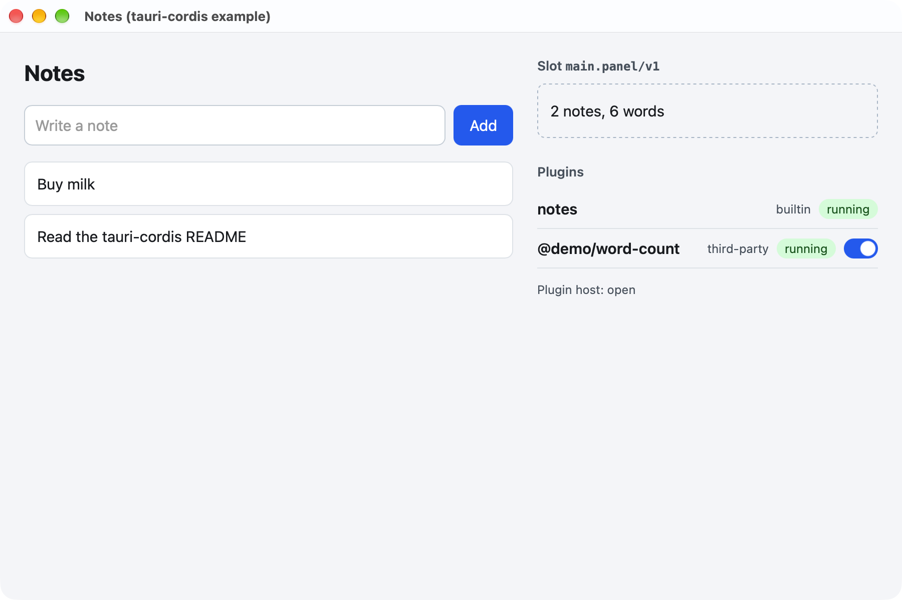

# tauri-cordis

**让用你 Tauri 应用的人自己扩展它。** 内置功能和第三方扩展是同一种东西：插件。每个插件都能在应用运行时开、关、替换。

[](https://www.npmjs.com/package/tauri-cordis) [](https://crates.io/crates/tauri-cordis) [](https://github.com/TixXin/tauri-cordis/actions/workflows/ci.yml) [](./LICENSE)

[English](./README.md) | 简体中文

> 这一页对应英文版 README（2026-11-19）。其余文档目前只有英文，[保证清单](./docs/guarantees.zh-CN.md)有中文版。

tauri-cordis 是从[浮屿](https://github.com/TixXin/fuyu)里拆出来的插件运行时。浮屿是 Windows 和 macOS 上的桌面灵动岛，这套架构在它上面实际跑着：22 个内置功能（剪贴板历史、翻译、歌词、待办等）都是插件，签名市场里的 12 个官方插件也是。

<p align="center">
  <a href="https://github.com/TixXin/fuyu"></a>
</p>

> **它不是 `tauri-plugin-*`。** Tauri 插件是开发者编译进应用的 Rust crate，用来给应用加一项能力。tauri-cordis 管的是另一个方向：应用发布之后，用户往里装的代码。

## 它提供什么

- **所有东西都是同一种插件。** 一个插件是一个 Node 模块（逻辑），有界面的再加每个窗口一个 React 组件。清单就是它的 `package.json`。
- **带版本的服务。** 插件之间通过有类型、名字里带版本的服务通信（`notes/v1`）。需要某个服务的插件，等有人提供了才启动；提供者停了它跟着停，回来了它自己再起。
- **界面插槽。** 窗口声明一些有名字的位置（`main.panel/v1`），插件往里放组件。每一项各有自己的错误边界，一个插件渲染出错不会让整个窗口白掉。
- **副作用自己撤掉。** 经 `ctx` 登记的定时器、监听器、服务、插槽项，插件停用时都会撤掉。同一个插件装卸 1000 次不留下任何句柄，这一条有测试守着。
- **被看管的宿主进程。** 插件跑在一个无界面的 Node 进程里，由 Rust 启动、发心跳、按退避重启。它和应用之间的管道一断就自己退出，另有 `Containment` 钩子可以把它放进 Job Object 或进程组。窗口通过本机 WebSocket 连它，每次启动换一个随机令牌。
- **不只是运行时，还有供应链。** 清单校验、可复现的安装包、Ed25519 签名、带撤销名单的签名市场索引，以及对比插件两个版本并给风险分级的审核工具。
- **六十多条写下来的保证，每条有测试。** 见[保证清单](./docs/guarantees.zh-CN.md)。

## 插件长什么样

服务只声明一次，提供方和使用方共用：

```ts
import { defineService } from "tauri-cordis/services";

type Note = { id: number; text: string };

export const notesV1 = defineService<
  { list(): Note[]; add(params: { text: string }): Note },
  { added: Note }
>("notes/v1", {
  methods: { list: true, add: true },
  events: { added: true },
});
```

插件跑在 Node 宿主里的那部分：

```ts
import type { Context } from "tauri-cordis";
import { notesV1 } from "./services";

export const name = "word-count";
export const inject = ["clients", "notes/v1"]; // 有人提供 notes/v1 之后才启动

export async function apply(ctx: Context) {
  const notes = ctx.services.get(notesV1);
  let count = (await notes.list()).length;

  ctx.clients.handle("count", () => count); // 窗口那部分可以调它
  notes.on("added", () => {
    count += 1;
    ctx.clients.publish("changed", count);
  });
}
```

跑在窗口里的那部分：

```tsx
import { useEffect, useState } from "react";
import type { Context } from "tauri-cordis";

export default function apply(ctx: Context) {
  function Count() {
    const [count, setCount] = useState(0);
    useEffect(() => {
      void ctx.host.call<number>("count").then(setCount);
      const off = ctx.host.on("changed", setCount);
      return () => void off();
    }, []);
    return <span>{count} 条笔记</span>;
  }

  ctx.slots.add("main.panel/v1", { id: "word-count", component: Count });
}
```

两个文件里都没有清理代码。插件被关掉时，处理函数、订阅和插槽项一起消失。

应用这边，内置插件可以调用你用 Rust 写的方法：

```rust
use tauri_cordis::host_service;

#[host_service("storage.write", inject(store))]
fn write(store: Store, text: String) -> Result<Note, String> {
    store.add(text)
}
```

```ts
const note = await ctx.rust.call("storage.write", { text }); // 只有内置插件能调
```

窗口把插件放进插槽的东西显示出来：

```tsx
<SlotItems registry={slots} name="main.panel/v1" />
```

## 跑一下

一个带窗口的小笔记应用：一个内置插件，加一个可以在运行时关掉的第三方插件。

```bash
git clone https://github.com/TixXin/tauri-cordis
cd tauri-cordis
pnpm install
pnpm --filter tauri-cordis-example-notes tauri dev
```

见 [examples/tauri-app](./examples/tauri-app)。

<p align="center">
  <a href="./examples/tauri-app"></a>
</p>

只想看协议的话，同样的四层可以不开窗口跑，用一个 Node 脚本充当原生外壳：

```bash
node packages/tauri-cordis/examples/minimal-app/run.mjs
```

给一个已经用了 tauri-cordis 的应用写插件：

```bash
npm create tauri-cordis-plugin@latest my-plugin
```

## 各部分怎么接

```text
┌──────────────────────────────┐    stdio JSON-RPC     ┌───────────────────────────────┐
│ 原生外壳（Rust，Tauri）      │ <-------------------> │ 插件宿主（Node，无界面）      │
│  启动、心跳、重启            │                       │  Cordis 上下文和加载器        │
│  #[host_service] 方法        │                       │  服务注册表                   │
└──────────────────────────────┘                       │  每个插件的宿主部分           │
               ^                                       └───────────────────────────────┘
               │ invoke                                                ^
               v                                                       │ 127.0.0.1 上的 WebSocket
┌──────────────────────────────────────────────────────────────────────┴────────────────┐
│ WebView 窗口（React）                                                                 │
│  插槽注册表 · 窗口服务 · 每个插件的窗口部分                                           │
└───────────────────────────────────────────────────────────────────────────────────────┘
```

- [概念](./docs/concepts.md)：插件、服务、插槽、生命周期、插件的两半。
- [接进你的应用](./docs/getting-started.md)：Rust 这边、窗口这边、内置插件。
- [写插件](./docs/writing-plugins.md)：清单、`ctx`、命令行、打包。
- [安全模型](./docs/security.md)：防得住什么，防不住什么。

## 代价

选它之前先看这几条。

- **要带 Node。** 宿主需要 Node 22.15 以上。Rust 这边先在机器上找，找不到就下载官方构建并核对 SHA-256。在浮屿里，闲置的宿主进程在 macOS 上约占 25 MB，开着和关着冷启动一样快（[实测](https://github.com/TixXin/fuyu/blob/main/docs/investigations/v3-kernel-measurements.md)）。0.2 里把宿主脚本打进应用包要你自己做，见[发布之前](./docs/getting-started.md#before-you-ship)。
- **插件不在沙箱里。** 插件的宿主部分就是普通的 Node 代码，权限和用户一样。「同权」就是这个意思，插件能干实事也是因为这个。防线在安装之前：签名、审核、撤销。如果你要跑完全不信任的代码，请用带隔离的方案。细节见[安全模型](./docs/security.md)。
- **插件界面用 React。** 插槽渲染的是 React 组件，插件和应用共用一份 React。
- **还在 0.x。** 小版本之间接口还可能变。哪些稳定、哪些不稳定见[稳定性](./docs/stability.md)。
- **有些默认值是定死的**：宿主只认清单键 `cordis`，插槽类型里列的是一套内置的插槽名。逐项列在[稳定性](./docs/stability.md#default-names)里，写了现在能怎么办。

## 和别的方案比

| | 用来做什么 | 什么时候加载 | 隔离 |
|---|---|---|---|
| **tauri-cordis** | 用户扩展你的应用；你自己的功能也是插件 | 运行时，开关不用重启 | 插件和应用之间没有；和界面不在一个进程 |
| `tauri-plugin-*` | 开发者给应用加一项能力 | 编译时 | Tauri 的能力和权限系统 |
| 沙箱插件（WebAssembly、iframe） | 跑不信任的代码 | 运行时 | 强；插件只拿得到你给的 |
| 只用 Cordis | 上下文、服务、可撤销副作用的内核 | 运行时 | 没有 |

tauri-cordis 就是 Cordis 加上桌面应用在它外面需要的那一圈：进程看管、到窗口的桥、界面插槽，以及打包和市场的工具。熟悉代码编辑器的扩展宿主的话，形状差不多。

## 包

| 包 | 发在哪 | 是什么 |
|---|---|---|
| [`tauri-cordis`](./packages/tauri-cordis) | npm | 插件接口、Node 宿主、窗口端、React 插槽、服务 |
| [`@tauri-cordis/cli`](./packages/cli) | npm | `tauri-cordis-plugin`：构建、打包、检查、开发联调、审核、生成密钥、签名 |
| [`create-tauri-cordis-plugin`](./packages/create-plugin) | npm | 生成插件项目 |
| [`@tauri-cordis/manifest`](./packages/manifest) | npm | 清单校验、可复现的 zip 包、签名 |
| [`@tauri-cordis/market`](./packages/market) | npm | 签名的市场索引、撤销名单、冷静期、选版本 |
| [`@tauri-cordis/review`](./packages/review) | npm | 对比插件的两个版本，把改动分成绿、黄、红 |
| [`tauri-cordis`](./crates/tauri-cordis) | crates.io | 宿主看管、找 Node 和下载 Node、JSON-RPC、方法注册 |
| [`tauri-cordis-macros`](./crates/tauri-cordis-macros) | crates.io | `#[host_service]`，经 `ts-rs` 生成 TypeScript 声明 |

## 代码从哪来

tauri-cordis 在[浮屿的仓库](https://github.com/TixXin/fuyu)里开发，从这个仓库发布。这里的源码由浮屿仓库里的一个导出脚本生成，CI 会核对两边一致。issue 和 PR 提在这个仓库就行，见 [CONTRIBUTING.md](./CONTRIBUTING.md)。

## 致谢

- [Cordis](https://github.com/cordiverse/cordis)（Shigma 和 Cordiverse 的贡献者）是内核：上下文、服务，以及插件一走就撤掉的副作用。它的构建产物放在 [`packages/tauri-cordis/vendor`](./packages/tauri-cordis/vendor)，带着许可证和几处本地改动的说明。
- [Tauri](https://tauri.app) 是这套东西所在的外壳。

## 开源协议

[MIT](./LICENSE)
