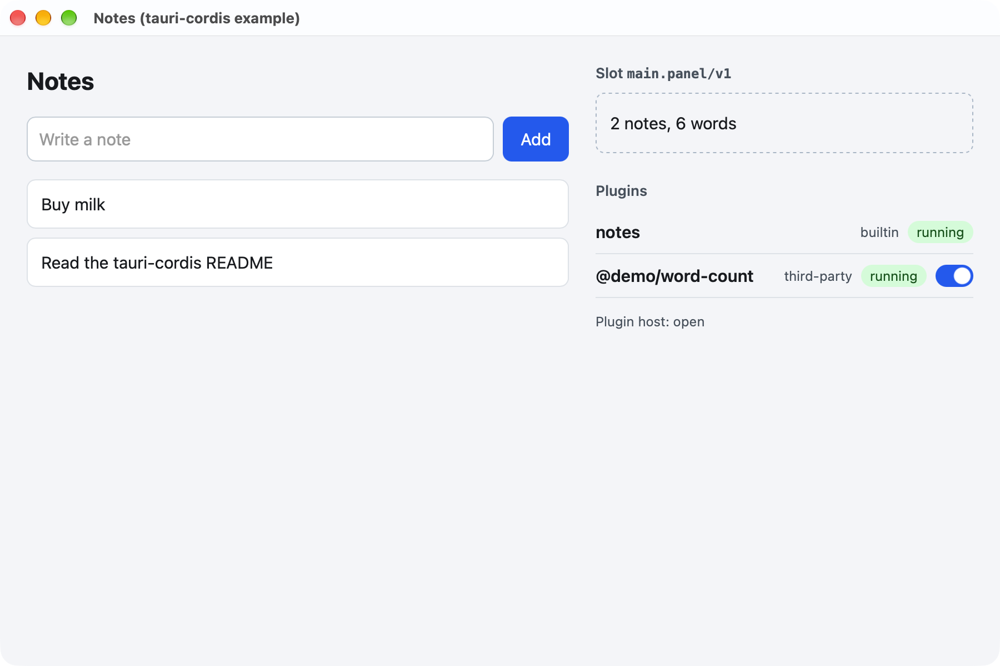

# Notes: a Tauri 2 app built on tauri-cordis

A small, real Tauri 2 + Vite + React app. Its one feature, a list of notes, is a plugin; a second
plugin adds a panel to the window. You can switch the second plugin off and on while the app runs.



## What it shows

1. **The Rust shell** finds Node, starts the plugin host and keeps it alive, gives plugins two Rust
   functions (`storage.read`, `storage.write`), tells the window where the host's socket is, and
   serves plugin window files.
2. **The Node plugin host** is `tauri-cordis/src/host/main.mjs`, run as it is. It loads the plugins,
   starts and stops them, and talks to Rust over stdio and to the window over a local WebSocket.
3. **A built-in plugin, `notes`**, turns the Rust functions into a service, `notes/v1`
   (`list`, `add`, event `added`). Only built-in plugins may call Rust.
4. **A third-party style plugin, `@demo/word-count`**, depends on `notes/v1` and puts a panel in the
   window slot `main.panel/v1`: "3 notes, 10 words". It updates when a note is added.

The window uses the same `notes/v1` service to list and add notes, so the app's own UI and a
third-party plugin go through one door.

## Run it

You need Rust, pnpm, the [Tauri prerequisites](https://tauri.app/start/prerequisites/) and Node 22.15 or newer.

```sh
pnpm install                                        # at the repository root
pnpm --filter tauri-cordis-example-notes tauri dev
```

Add a note and watch the panel count it. Flip the switch next to `@demo/word-count`: the panel goes
away and the plugin's state becomes `disabled`. Flip it back and the panel returns. Nothing restarts.

The app can also check itself. With `NOTES_SELFTEST=1` the window does the steps above on its own,
prints what it saw as one line of JSON, and exits with 0 (all as expected) or 1:

```sh
NOTES_SELFTEST=1 pnpm --filter tauri-cordis-example-notes tauri dev
```

## What happens when you flip the switch

1. The window calls the Tauri command `set_word_count_enabled`.
2. Rust rewrites `plugins.yml` in the app's data folder (`disabled: true`, or without it).
3. The host was started with `--watch`, so it reads the file again and stops or starts the plugin.
4. The host sends the window the new plugin list and the new list of window files.
5. The window's loader drops (or imports) the plugin's `window.mjs`. Dropping it removes everything
   the plugin added through `ctx`, so the panel leaves the slot.

## File map

| Layer | File | What it does |
|---|---|---|
| Rust shell | `src-tauri/src/host.rs` | Finds Node, starts the host, hands out the socket's port and token, writes `plugins.yml` |
| | `src-tauri/src/storage.rs` | The two `#[host_service]` functions |
| | `src-tauri/src/assets.rs` | The `notes-plugin://` scheme: plugin window files and the shared React |
| | `src-tauri/src/main.rs` | Puts the three together |
| Service | `plugins/services.mjs`, `.d.mts` | The definition of `notes/v1` and its types |
| Built-in plugin | `plugins/builtins/builtins.json` | Lists the built-in plugins for the host |
| | `plugins/builtins/notes/host.mjs` | Provides `notes/v1` by calling Rust |
| Third-party plugin | `plugins/word-count/package.json` | The manifest: what it needs, which slot it fills |
| | `plugins/word-count/host.mjs` | Counts, and publishes the count to its window code |
| | `plugins/word-count/window.mjs` | A React component added to the slot |
| Window | `src/plugins.ts` | Connects to the host; sets up services, slots and the loader |
| | `src/App.tsx`, `Notes.tsx`, `PluginList.tsx` | The UI |
| Self-test | `src/selftest.ts`, `src-tauri/src/selftest.rs` | Only used with `NOTES_SELFTEST=1` |

## What to copy into your own app

In this order; each step works before the next one exists.

1. **Dependencies.** The `tauri-cordis` crate (and `ts-rs`, which `#[host_service]` needs in test
   builds) in `Cargo.toml`; the `tauri-cordis` package in `package.json`.
2. **Start the host**: `host.rs`, `start` to `on_event`. Run the app and look for `[host] ready`.
3. **Give plugins something from Rust**: `storage.rs`, plus `Serve::registered()` and `serve.manage(...)`.
4. **A built-in plugin and a service**: `plugins/services.mjs`, `plugins/builtins/`, and the `--builtins` flag.
5. **Connect the window**: the command `host_connection` and `src/plugins.ts` up to `connectHost`.
   Allow `ws://127.0.0.1:*` in the CSP (`tauri.conf.json`). Now the window can call `notes/v1`.
6. **Let plugins into the window**: `assets.rs` and its scheme in the CSP, then `createSlots`,
   `installShared`, `createLoader` in `src/plugins.ts` and `<SlotItems>` where the slot is.
7. **Installing and switching plugins**: `install_word_count` and `write_plugins_file` show the two
   things the host reads, `<dir>/packages/<name>/` and `<dir>/plugins.yml`.

## What it leaves out

- **Shipping.** The example runs from this checkout: the host script and the plugins are read from
  the source tree, and `bundle.active` is `false`. A shipped app must put the host (with its
  dependencies) and its built-in plugins in the bundle and point `HOST_SCRIPT` and `BUILTINS` there.
- **A build step for plugins.** `word-count` is plain `.mjs` written by hand. A real plugin is
  usually built with `tauri-cordis-plugin build`.
- **A plugin market, permissions, settings pages, saving the notes.** The notes live in memory.
- **Containment.** It passes `NoContainment`. An app should end the host and what it started when
  the app dies (a Job Object on Windows, a process group elsewhere).
